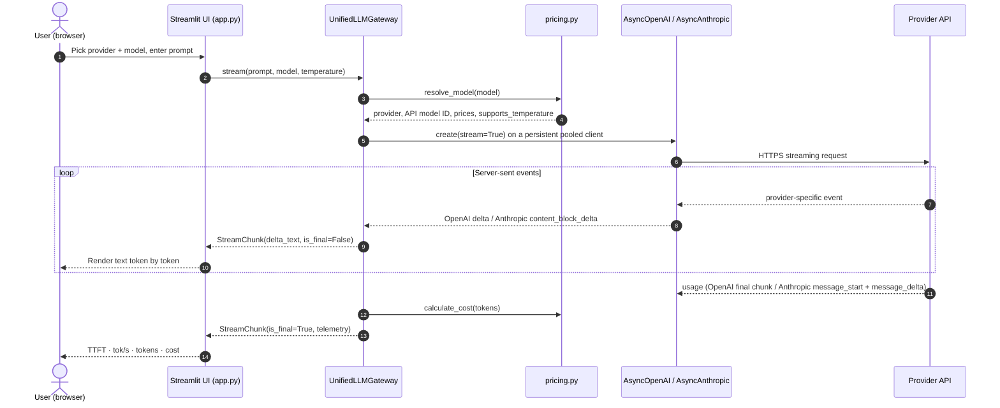

# ⚡ Multi-Provider Async LLM Gateway

## 1. Project Overview & Architecture

`UnifiedLLMGateway` is one async Python interface that streams responses from **OpenAI** and **Anthropic** in a single normalized format (`StreamChunk`). The final chunk carries telemetry: time to first token (TTFT), tokens per second, prompt/completion tokens, and USD cost to six decimals. A Streamlit UI lets you switch providers and compare them.



```
multi-provider-llm-gateway/
├── pyproject.toml          # uv project + pytest config
├── .env.example            # key placeholders (real .env is git-ignored)
├── ai_prompt_log.md        # AI prompt, raw output, and full audit
├── src/
│   ├── schemas.py          # StreamChunk, ChunkTelemetry (Pydantic v2)
│   ├── pricing.py          # Model registry + Decimal cost math
│   ├── gateway.py          # UnifiedLLMGateway, typed exceptions, secret redaction
│   └── app.py              # Streamlit UI
└── tests/
    ├── conftest.py         # Fake OpenAI / Anthropic stream clients
    ├── test_gateway.py     # Stream protocol, token count, telemetry
    └── test_security.py    # Key handling, secret redaction
```

## 2. Environment & Prerequisites

- **Python 3.11+**
- **[uv](https://docs.astral.sh/uv/)** for dependency management

```bash
git clone https://github.com/HJLee82/AD331_2026AU.git
cd AD331_2026AU/WEEK02/multi-provider-llm-gateway
uv sync
```

`uv sync` creates `.venv/` and installs everything pinned in `uv.lock`.

## 3. Configuration & Security

```bash
cp .env.example .env
```

Edit `.env` with your keys (no quotes, no spaces around `=`):

```
OPENAI_API_KEY=sk-proj-...
ANTHROPIC_API_KEY=sk-ant-...
```

- `.env` is in `.gitignore` and is never committed.
- Keys are read on the server only. They never reach the browser and are redacted from every error and log line.
- Missing or malformed keys raise a typed `AuthenticationError` that names the variable to set, without echoing the value.
- On Streamlit Community Cloud, set the same two keys in **App settings → Secrets**.

## 4. Execution Instructions

Run from the `multi-provider-llm-gateway/` folder:

```bash
# Web UI (opens http://localhost:8501)
uv run streamlit run src/app.py

# Test suite
uv run pytest -v
```

Optional command-line demo:

```bash
uv run python -m src.gateway gpt-4o-mini
uv run python -m src.gateway claude-haiku-5-5
```

## 5. Pricing Matrix

USD per 1 million tokens, checked against the official pricing pages on 2026-11-04.

| Provider | Model ID | Input | Output | Cached input | Cache write |
|---|---|---|---|---|---|
| OpenAI | `gpt-4o-mini` | $0.15 | $0.60 | $0.075 | – |
| OpenAI | `gpt-4o` | $2.50 | $10.00 | $1.25 | – |
| Anthropic | `claude-sonnet-5-5` | $2.00 | $10.00 | $0.20 | $2.50 |
| Anthropic | `claude-haiku-5-5` | $0.10 | $0.50 | $0.01 | $0.125 |

**Cost formula:** `(uncached_input × input + cache_read × cached + cache_write × write + output × output) / 1,000,000`, computed with `Decimal` to avoid floating-point drift.

- `claude-haiku-5-5` has tiered pricing: prompts over 100K tokens cost $0.50 / $2.50. The table uses the ≤100K rate, which covers every request this gateway makes.
- The assignment's `claude-3-5-sonnet` / `claude-3-5-haiku` were retired (2025-10-28 / 2026-02-19) and replaced with the Claude 5.5 models.

## 6. Audit & Verification Summary

The baseline was generated by an AI assistant from the assignment's sample prompt and committed unedited (`AI raw draft`). Full prompt, raw output and diffs are in [`ai_prompt_log.md`](ai_prompt_log.md).

**Verified correct in the AI draft:** async-only clients, OpenAI empty-`choices` final chunk, Anthropic event handling, TTFT at the first non-empty delta, `Decimal` cost math, persistent clients, key redaction.

| # | Discrepancy in the AI draft | Impact | Fix in final code |
|---|---|---|---|
| B1 | Retired `claude-3-5-*` model IDs | Every Anthropic call failed | Current Claude 5.5 IDs and prices |
| B2 | Absolute imports inside the `src` package | Tests and app could not import the gateway | Relative imports + pytest `pythonpath` |
| B3 | `.env` never loaded | Valid keys were ignored | `load_dotenv` at entry points only |
| B4 | Field/exception names differ from spec; no malformed-key check | Spec tests could not pass | `ttft_ms`, `total_cost_usd`, `AuthenticationError`, prefix checks |
| B5 | `temperature` forced through `extra_body` | Claude 5.x returned HTTP 400 | Per-model `supports_temperature` flag |

**Verification:** `uv run pytest -v` → 13 passed. Tests use fake clients shaped like the real SDK stream events (no network, no cost), except one live token-count check against tiktoken. Putting audit bugs back into the code makes the matching tests fail.
